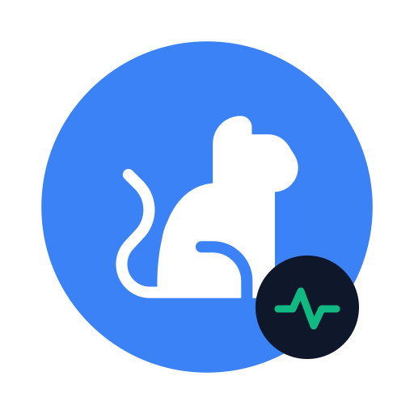
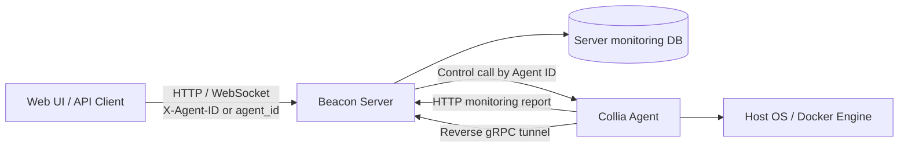

> [!IMPORTANT]
> **Repository rename:** this repository has moved from `amuluze/amprobe` to `amuluze/beacon-pro`. GitHub temporarily redirects old links, but existing clones should run `git remote set-url origin git@github.com:amuluze/beacon-pro.git` and update bookmarks, badges, and automation to the new address.

<p align="center">
  
</p>

<h1 align="center">Beacon</h1>

<p align="center">
  <strong>An open-source, lightweight and modern host & Docker monitoring platform</strong><br />
  <sub>开源、轻量、现代化的主机与 Docker 容器监控平台</sub>
</p>

<p align="center">
  <a href="https://github.com/amuluze/beacon-pro/stargazers"></a>
  <a href="https://github.com/amuluze/beacon-pro/releases"></a>
  
  
  <a href="./LICENSE"></a>
</p>

<p align="center">
  <a href="./README.md">中文</a> · English
</p>

---

<p align="center">
  <a href="#-introduction">Introduction</a> ·
  <a href="#-features">Features</a> ·
  <a href="#-architecture">Architecture</a> ·
  <a href="#-quick-start">Quick Start</a> ·
  <a href="#%EF%B8%8F-tech-stack">Tech Stack</a> ·
  <a href="#-project-structure">Project Structure</a> ·
  <a href="#-documentation">Documentation</a>
</p>

---

## 📖 Introduction

**Beacon** is a Server-Agent platform for host monitoring and Docker container management. It is designed for individual developers and small teams that need one place to observe and operate multiple servers.

- **Beacon Server** provides the Web UI, HTTP API, authentication, authorization, auditing, monitoring storage, and task orchestration.
- **Collia Agent** collects host and Docker metrics, reports monitoring batches over HTTP, and opens a reverse gRPC tunnel for Server-initiated control calls.
- Query and control requests must explicitly select an Agent, preventing implicit fallback or cross-node reads.

Website: [beacon.amuluze.com](https://beacon.amuluze.com) · Repository: [github.com/amuluze/beacon-pro](https://github.com/amuluze/beacon-pro)

## ✨ Features

### 🐳 Docker management

- Inspect Docker versions and runtime status.
- Create, start, stop, restart, delete, and inspect container logs.
- Import, export, delete, and clean dangling images.
- Create, delete, and inspect Docker networks.

### 🖥️ Host monitoring

- Inspect host name, uptime, distribution, kernel, and operating system.
- Track CPU, memory, disk IO, and network IO trends.
- Configure CPU, memory, and disk usage thresholds with email or optionally signed DingTalk group robot Webhook notifications.
- Perform container operations through an explicitly selected Agent.

### 🔐 Access control and auditing

- User, role, and API permission management.
- Login, logout, and system operation audit records.
- Production checks for signing keys, Agent join tokens, and install tokens.

### 🔄 Agent lifecycle

- Agent version reporting and online status tracking.
- Collia amd64/arm64 packages are distributed by the Beacon image.
- Remote update, self-update, uninstall, and reverse-tunnel control flows.

## 🏗️ Architecture



Beacon keeps three paths distinct:

1. **Monitoring queries** read the selected Agent's data from the Server-side monitoring database.
2. **Monitoring reports** are atomically persisted in batches sent by Collia over HTTP.
3. **Control calls** target an Agent through the reverse gRPC tunnel opened by Collia.

See [System Architecture](./.docs/architecture.md) and [Data Flow](./.docs/concepts/data-flow.md) for the complete boundaries and dependency direction.

## 🚀 Quick Start

### Online installer (recommended)

```bash
bash -c "$(curl -fsSL https://beacon.amuluze.com/release/latest/manager.sh)" -- install BEACON_PUBLIC_BASE_URL=https://beacon.example.com
```

Production mode accepts HTTPS only. First provide a trusted reverse proxy that forwards this HTTPS origin to Beacon's Web port. The installer then configures the ports and generates authentication, data-encryption, and bootstrap-administrator credentials. `BEACON_DATA_ENCRYPTION_KEY` is stored in the mode-`0600` `.env` file and must be retained permanently.

### Run from source

Prerequisites:

- Docker >= 20.10.9 with Docker Compose.
- Go 1.25 for local backend development.
- Node.js, pnpm, and [Task](https://taskfile.dev/) to build Web assets.

```bash
# Clone the renamed repository
git clone https://github.com/amuluze/beacon-pro.git
cd beacon-pro

# Build frontend assets
task beacon-web:install
task beacon-web:build

# Build the Beacon image and start the local Compose stack
docker build -f beacon/Dockerfile -t beacon:latest .
cp website/release/latest/.env.example website/release/latest/.env
# Edit .env: set BEACON_IMAGE=beacon:latest (locally built image) and fill in the four required secrets
docker compose -f website/release/latest/compose.yaml up -d

# Verify
curl http://127.0.0.1:1443/health
```

The local Compose stack (`website/release/latest/compose.yaml`) exposes `1443` for HTTP (override with `BEACON_HTTP_PORT`) and `17000` for Agent control (override with `BEACON_CONTROL_PORT`) and is intended for development and verification. `BEACON_AGENT_INSTALL_TOKEN`, `BEACON_AUTH_SIGNING_KEY`, `BEACON_CONTROL_JOIN_TOKEN`, and `BEACON_DATA_ENCRYPTION_KEY` are required (Compose fails to start without them); for production, generate unique high-entropy secrets. A new database also requires `BEACON_BOOTSTRAP_ADMIN_PASSWORD`.

After Beacon starts, install Collia on a target host (replace the address, node number, and token with real values):

```bash
curl -fsSL 'https://<beacon-host>/api/v1/host/install?node=1' | sudo bash -s -- --token=<install-token>
```

- `node` is the agent identity: it starts with a letter or digit and may contain letters, digits, dots, underscores and hyphens. Reinstalling on the same host overwrites the config and registers under the new identity.
- The install token comes from the "Install Agent" dialog in the console (or the admin-only `POST /api/v1/host/get_install_token`). The script also sends it when downloading the package, config and certificates.
- With a self-signed control certificate, import the CA into the target host trust store first, otherwise the script's `curl -fsSL` fails: copy `ca.pem` from the Server host's `$BEACON_CONTROL_CERT_DIR` (default `/data/beacon/control-certs`) to `/usr/local/share/ca-certificates/beacon-ca.crt` and run `sudo update-ca-certificates`.
- Agent auto-update is enabled by default: agents upgrade to the version bundled in the Server image on reconnect. Disable it under Settings → Probes, where a per-row manual upgrade is also available.
- Uninstall with `sudo collia remove` (removes the binary, config, local data and system service registration).

### Optional installation reporting

Installation reporting is disabled by default and sends nothing without explicit opt-in. Beacon sends one installation report only after an administrator sets `Enable = true` under `[InstallReport]` in `beacon/configs/config.toml`. The report is sent to the configured `URL`, which defaults to `https://beacon.amuluze.com/api/v1/install/report`.

The payload contains only `install_id`, `image`, `version`, `public_base_url`, `install_dir`, `http_port`, `control_port`, `container_name`, and `hostname`. `install_id` is a random identifier persisted locally. The request does not contain administrator accounts, passwords, authentication tokens, DingTalk Webhooks, SMTP passwords, or monitoring data.

## 🛠️ Tech Stack

| Layer | Technology |
|---|---|
| Web frontend | Vue 3, TypeScript, Vite, Element Plus, Pinia, ECharts |
| Server | Go 1.25, Fiber, GORM, WebSocket |
| Agent | Go, gopsutil, Docker Engine API |
| Control channel | Agent-initiated reverse gRPC tunnel |
| Monitoring channel | HTTP batch reporting and Server-side persistence |
| Storage | SQLite, with other databases available through GORM |
| Deployment | Docker, Docker Compose |

## 📁 Project Structure

```text
beacon-pro/
├── beacon/                 # Server, Web UI, HTTP/WS API, and tunnel client
│   ├── cmd/beacon/         # Server process entrypoint
│   ├── service/            # Business services, routing, auth, and persistence
│   └── web/                # Vue 3 admin UI
├── collia/                 # Agent collection, host/Docker ops, tunnel service
├── common/                 # Shared schemas, database, and tunnel transport
├── website/                # Product website, installer, and release artifacts
│   ├── compose.yml         # Local dev Compose (NODE_ENV=development)
│   ├── docker-compose.yml  # Production Compose (NODE_ENV=production)
│   └── release/latest/     # Online installer bundle (manager.sh / compose.yaml / SHA256SUMS)
├── .docs/                  # Current implementation documentation
├── .specs/                 # SDD Domain and Task Specs
└── Taskfile.yml            # Workspace command entrypoint
```

## 📚 Documentation

| Document | Contents |
|---|---|
| [Architecture](./.docs/architecture.md) | Module boundaries, runtime paths, and dependency direction |
| [Data Flow](./.docs/concepts/data-flow.md) | Request lifecycle, data ownership, and cross-module flow |
| [Deployment](./.docs/deployment.md) | Environment, build, configuration, and release checks |
| [API Routes](./.docs/api/routes.md) | Current HTTP route and handler index |
| [OpenAPI](./.docs/api/openapi.yml) | Beacon HTTP API contract |
| [Domain Constraints](./.specs/domain/monitoring-platform.md) | Durable monitoring behavior and invariants |
| [Account Administration Constraints](./.specs/domain/account-administration.md) | Admin user maintenance, deletion targets, and failure semantics |

## 🧑‍💻 Development and Contributing

Common commands:

```bash
task beacon:dev
task beacon-web:dev
task collia:amd64

cd beacon && go test ./...
cd collia && go test ./...
cd common && go test ./...
cd beacon/web && pnpm test:run && pnpm ts && pnpm build
```

Issues and pull requests are welcome:

1. Fork [this repository](https://github.com/amuluze/beacon-pro).
2. Create a focused branch and run the relevant checks.
3. Commit a clear, reviewable change.
4. Push the branch and open a Pull Request.

## ☕ Support and Contact

Beacon is maintained in the author's spare time. If it helps you, please give the project a ⭐ or consider buying the author a coffee.

<details>
<summary>Donation and contact QR codes</summary>

<p>
  
  
  
</p>

</details>

## 📄 License

Beacon is open source under the [MIT License](./LICENSE).

## 🙏 Acknowledgements

Special thanks to [JetBrains](https://www.jetbrains.com/) for supporting open-source development tools.

---

<p align="center">
  <sub>Built with ❤️ and ☕</sub>
</p>
