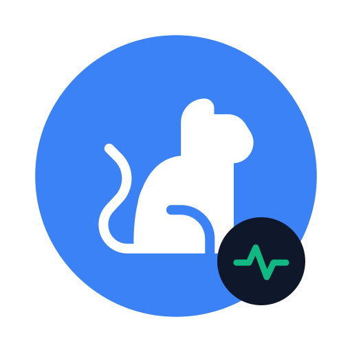
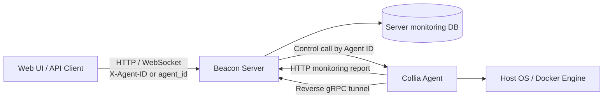

<p align="center">
  
</p>

<h1 align="center">Beacon</h1>

<p align="center">
  <strong>开源、轻量、现代化的主机与 Docker 容器监控平台</strong><br />
  <sub>An open-source, lightweight and modern host & Docker monitoring platform</sub>
</p>

<p align="center">
  <a href="https://github.com/amuluze/beacon-pro/stargazers"></a>
  <a href="https://github.com/amuluze/beacon-pro/releases"></a>
  
  
  <a href="./LICENSE"></a>
</p>

<p align="center">
  中文 · <a href="./README.en.md">English</a>
</p>

---

<p align="center">
  <a href="#-项目简介">项目简介</a> ·
  <a href="#-功能特性">功能特性</a> ·
  <a href="#-系统架构">系统架构</a> ·
  <a href="#-快速开始">快速开始</a> ·
  <a href="#%EF%B8%8F-技术栈">技术栈</a> ·
  <a href="#-项目结构">项目结构</a> ·
  <a href="#-项目文档">项目文档</a>
</p>

---

## 📖 项目简介

**Beacon** 是一个采用 Server-Agent 架构的主机监控与 Docker 容器管理平台，面向需要统一观察、管理多台服务器的个人开发者与小型团队。

- **Beacon Server** 提供 Web UI、HTTP API、认证授权、审计、监控数据存储与任务编排。
- **Collia Agent** 采集主机和 Docker 指标，通过 HTTP 上报监控批次，并主动建立反向 gRPC tunnel 接收 Server 控制调用。
- 查询与控制请求必须显式指定 Agent，避免默认节点回退或跨节点读取。

官网：[beacon.amuluze.com](https://beacon.amuluze.com) · 仓库：[github.com/amuluze/beacon-pro](https://github.com/amuluze/beacon-pro)

## ✨ 功能特性

### 🐳 Docker 管理

- 查看 Docker 版本与运行状态。
- 管理容器的创建、启动、停止、重启、删除与日志。
- 管理镜像导入、导出、删除和虚悬镜像清理。
- 创建、删除并查看 Docker 网络状态。

### 🖥️ 主机监控

- 查看主机名、启动时间、发行版、内核与系统类型。
- 观察 CPU、内存、磁盘 IO 与网络 IO 趋势。
- 配置 CPU、内存和磁盘使用率告警阈值及统一消息标题，通过邮件或支持可选加签的钉钉群机器人 Webhook 接收通知。
- 通过明确选择的 Agent 执行容器控制操作。

### 🔐 权限与审计

- 用户、角色与接口权限管理。
- 登录、登出和系统操作审计。
- 生产模式下校验签名密钥、Agent 加入令牌与安装令牌。

### 🔄 Agent 生命周期

- Agent 版本上报与在线状态跟踪。
- Collia amd64/arm64 安装包由 Beacon 镜像统一提供。
- 支持远程更新、自更新、卸载和反向 tunnel 控制。

## 🏗️ 系统架构



Beacon 将三条路径明确分离：

1. **监控查询**：Web 请求从 Server 本地监控表读取指定 Agent 的数据。
2. **监控上报**：Collia 通过 HTTP report 接口按批次原子写入 Server。
3. **控制调用**：Beacon 通过 Collia 主动建立的反向 gRPC tunnel 调用目标 Agent。

更完整的边界、依赖方向和数据流见 [架构文档](./.docs/architecture.md) 与 [数据流文档](./.docs/concepts/data-flow.md)。

## 🚀 快速开始

### 在线安装（推荐）

```bash
bash -c "$(curl -fsSL https://beacon.amuluze.com/release/latest/manager.sh)" -- install BEACON_PUBLIC_BASE_URL=https://beacon.example.com
```

生产模式只接受 HTTPS。请先准备将该 HTTPS 地址转发到 Beacon Web 端口的可信反向代理；安装脚本会引导配置 Web 端口、Agent 控制端口，并生成认证、数据加密和首次管理员凭据。`BEACON_DATA_ENCRYPTION_KEY` 会保存在权限为 `0600` 的 `.env` 中且必须永久保留。

### 从源码启动

环境要求：

- Docker >= 20.10.9，并安装 Docker Compose。
- Go 1.25（本地开发后端时需要）。
- Node.js、pnpm 与 [Task](https://taskfile.dev/)（构建 Web 资源时需要）。

```bash
# 克隆新仓库
git clone https://github.com/amuluze/beacon-pro.git
cd beacon-pro

# 构建前端静态资源
task beacon-web:install
task beacon-web:build

# 构建 Beacon 镜像并启动本地 Compose
docker build -f beacon/Dockerfile -t beacon:latest .
cp website/release/latest/.env.example website/release/latest/.env
# 编辑 .env：设置 BEACON_IMAGE=beacon:latest（本机构建镜像）并填写四个必需密钥
docker compose -f website/release/latest/compose.yaml up -d

# 验证服务
curl http://127.0.0.1:1443/health
```

本地 Compose（`website/release/latest/compose.yaml`）默认暴露 `1443`（HTTP，可用 `BEACON_HTTP_PORT` 覆盖）与 `17000`（Agent control，可用 `BEACON_CONTROL_PORT` 覆盖）端口，仅用于开发/验证。`BEACON_AGENT_INSTALL_TOKEN`、`BEACON_AUTH_SIGNING_KEY`、`BEACON_CONTROL_JOIN_TOKEN`、`BEACON_DATA_ENCRYPTION_KEY` 为必填项（缺失时 Compose 直接启动失败），生产部署请生成独立的高强度密钥；首次建库还需设置 `BEACON_BOOTSTRAP_ADMIN_PASSWORD`。

Beacon 启动后，可从目标主机安装 Collia Agent（将地址、节点编号和 Token 替换为实际值）：

```bash
curl -fsSL 'https://<beacon-host>/api/v1/host/install?node=1' | sudo bash -s -- --token=<install-token>
```

- `node` 是 Agent 标识：字母或数字开头，仅含字母、数字、点、下划线、短横线；同一主机重复安装会以新标识覆盖配置并注册。
- 安装 Token 由管理面板「安装 Agent」对话框获取（或管理员调用 `POST /api/v1/host/get_install_token`）；脚本内部下载安装包、配置与证书的请求同样携带该 Token。
- Beacon 使用自签控制证书时，需先把 CA 导入目标主机信任库，否则脚本内 `curl -fsSL` 会失败：将 Server 宿主机 `$BEACON_CONTROL_CERT_DIR`（默认 `/data/beacon/control-certs`）下的 `ca.pem` 复制到 `/usr/local/share/ca-certificates/beacon-ca.crt` 后执行 `sudo update-ca-certificates`。
- 安装后默认开启 Agent 自动更新：Agent 重连时按 Server 镜像内置版本自动升级；可在「设置 → 探针管理」关闭自动更新，或在该页行内手动升级。
- 卸载：`sudo collia remove`（同时清理二进制、配置、本地数据与系统服务注册）。

### 可选安装统计

安装统计默认关闭，不会在未授权的情况下发送。只有管理员在 `beacon/configs/config.toml` 的 `[InstallReport]` 中显式设置 `Enable = true` 后，Beacon 才会向配置的 `URL`（默认 `https://beacon.amuluze.com/api/v1/install/report`）发送一次安装信息。

发送字段仅包括：`install_id`、`image`、`version`、`public_base_url`、`install_dir`、`http_port`、`control_port`、`container_name`、`hostname`。其中 `install_id` 是本地持久化的随机安装标识；该请求不包含管理员账号、密码、认证令牌、钉钉 Webhook、SMTP 密码或监控数据。

## 🛠️ 技术栈

| 层级 | 技术 |
|---|---|
| Web 前端 | Vue 3、TypeScript、Vite、Element Plus、Pinia、ECharts |
| Server | Go 1.25、Fiber、GORM、WebSocket |
| Agent | Go、gopsutil、Docker Engine API |
| 控制通道 | Agent 主动连接的反向 gRPC tunnel |
| 监控通道 | HTTP 批次上报与 Server 本地持久化 |
| 数据存储 | SQLite，支持通过 GORM 扩展其他数据库 |
| 部署 | Docker、Docker Compose |

## 📁 项目结构

```text
beacon-pro/
├── beacon/                 # Server、Web UI、HTTP/WS API 与 tunnel client
│   ├── cmd/beacon/         # Server 进程入口
│   ├── service/            # 业务服务、路由、认证与数据访问
│   └── web/                # Vue 3 管理端
├── collia/                 # Agent 采集、Docker/主机操作与 tunnel service
├── common/                 # 共享 schema、数据库与 reverse tunnel transport
├── website/                # Beacon 官网、安装脚本与发布产物
│   ├── compose.yml         # 本地开发 Compose（NODE_ENV=development）
│   ├── docker-compose.yml  # 生产 Compose（NODE_ENV=production）
│   └── release/latest/     # 在线安装包（manager.sh / compose.yaml / SHA256SUMS）
├── .docs/                  # 当前实现文档
├── .specs/                 # SDD Domain / Task Specs
└── Taskfile.yml            # 工作区开发命令入口
```

## 📚 项目文档

| 文档 | 内容 |
|---|---|
| [架构设计](./.docs/architecture.md) | 模块边界、核心运行链路与依赖方向 |
| [数据流](./.docs/concepts/data-flow.md) | 请求生命周期、数据归属与跨模块流转 |
| [部署指南](./.docs/deployment.md) | 环境、构建、配置与发布检查 |
| [API 路由](./.docs/api/routes.md) | 当前 HTTP 路由与处理器索引 |
| [OpenAPI](./.docs/api/openapi.yml) | Beacon HTTP API 契约 |
| [账户管理约束](./.specs/domain/account-administration.md) | 管理员用户维护、删除目标与失败语义 |
| [领域约束](./.specs/domain/monitoring-platform.md) | 监控平台长期行为与不变量 |

## 🧑‍💻 开发与贡献

常用命令：

```bash
task beacon:dev
task beacon-web:dev
task collia:amd64

cd beacon && go test ./...
cd collia && go test ./...
cd common && go test ./...
cd beacon/web && pnpm test:run && pnpm ts && pnpm build
```

欢迎提交 Issue 和 Pull Request：

1. Fork [本仓库](https://github.com/amuluze/beacon-pro)。
2. 创建功能分支并完成最小验证。
3. 提交清晰、可审查的变更。
4. 推送分支并创建 Pull Request。

## ☕ 支持项目与联系作者

Beacon 由作者利用业余时间持续维护。如果项目对你有帮助，欢迎给仓库点一个 ⭐，也可以请作者喝杯咖啡。

<details>
<summary>展开赞赏码与联系方式</summary>

<p>
  
  
  
</p>

</details>

## 📄 License

Beacon 基于 [MIT License](./LICENSE) 开源。

## 🙏 鸣谢

特别感谢 [JetBrains](https://www.jetbrains.com/) 为开源项目提供开发工具支持。

---

<p align="center">
  <sub>用 ❤️ 与 ☕ 打造 · Built with ❤️ and ☕</sub>
</p>
