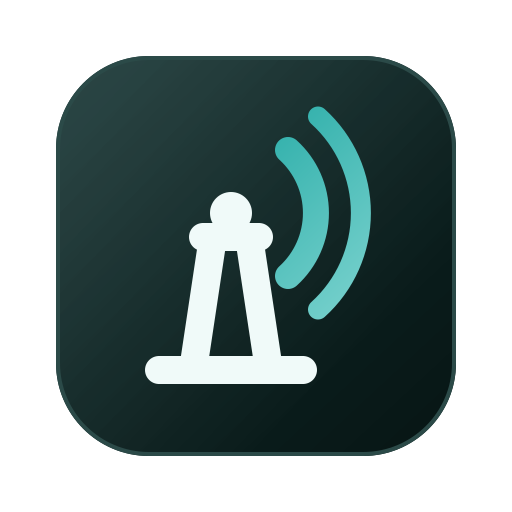
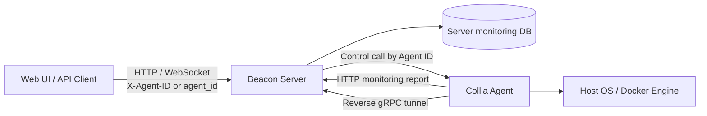

<p align="center">
  
</p>

<h1 align="center">Beacon</h1>

<p align="center">
  <strong>开源、轻量、现代化的主机与 Docker 容器监控平台</strong><br />
  <sub>An open-source, lightweight and modern host & Docker monitoring platform</sub>
</p>

<p align="center">
  <a href="https://github.com/amuluze/beacon/stargazers"></a>
  <a href="https://github.com/amuluze/beacon/releases"></a>
  
  
  <a href="./LICENSE"></a>
</p>

<p align="center">
  中文 · <a href="./README.en.md">English</a>
</p>

---

<p align="center">
  <a href="#-项目简介">项目简介</a> ·
  <a href="#-功能特性">功能特性</a> ·
  <a href="#-系统架构">系统架构</a> ·
  <a href="#-快速开始">快速开始</a> ·
  <a href="#%EF%B8%8F-技术栈">技术栈</a> ·
  <a href="#-项目结构">项目结构</a> ·
  <a href="#-项目文档">项目文档</a>
</p>

---

## 📖 项目简介

**Beacon** 是一个采用 Server-Agent 架构的主机监控与 Docker 容器管理平台，面向需要统一观察、管理多台服务器的个人开发者与小型团队。

- **Beacon Server** 提供 Web UI、HTTP API、认证授权、审计、监控数据存储与任务编排。
- **Collia Agent** 采集主机和 Docker 指标，通过 HTTP 上报监控批次，并主动建立反向 gRPC tunnel 接收 Server 控制调用。
- 查询与控制请求必须显式指定 Agent，避免默认节点回退或跨节点读取。

官网：[beacon.amuluze.com](https://beacon.amuluze.com) · 仓库：[github.com/amuluze/beacon](https://github.com/amuluze/beacon)

## ✨ 功能特性

### 🐳 Docker 管理

- 查看 Docker 版本与运行状态。
- 管理容器的创建、启动、停止、重启、删除与日志。
- 管理镜像导入、删除和虚悬镜像清理。
- 创建、删除并查看 Docker 网络状态。

### 🖥️ 主机监控

- 查看主机名、启动时间、发行版、内核与系统类型。
- 观察 CPU、内存、磁盘 IO 与网络 IO 趋势。
- 配置 CPU、内存和磁盘使用率告警阈值及统一消息标题，通过邮件或支持可选加签的钉钉群机器人 Webhook 接收通知。
- 通过明确选择的 Agent 执行容器控制操作。

### 🔐 权限与审计

- 用户、角色与接口权限管理。
- 登录、登出和系统操作审计。
- 生产模式下校验签名密钥、Agent 加入令牌与安装令牌。

### 🔄 Agent 生命周期

- Agent 版本上报与在线状态跟踪。
- Collia amd64/arm64 安装包由 Beacon 镜像统一提供。
- 支持远程更新、自更新、卸载和反向 tunnel 控制。

## 🏗️ 系统架构



Beacon 将三条路径明确分离：

1. **监控查询**：Web 请求从 Server 本地监控表读取指定 Agent 的数据。
2. **监控上报**：Collia 通过 HTTP report 接口按批次原子写入 Server。
3. **控制调用**：Beacon 通过 Collia 主动建立的反向 gRPC tunnel 调用目标 Agent。

更完整的模块实现事实见 [`.docs/modules/beacon.md`](./.docs/modules/beacon.md)。

## 🚀 快速开始

### 在线安装（推荐）

```bash
bash -c "$(curl -fsSL https://beacon.amuluze.com/release/latest/manager.sh)" -- install BEACON_PUBLIC_BASE_URL=https://beacon.example.com
```

生产模式只接受 HTTPS。请先准备将该 HTTPS 地址转发到 Beacon Web 端口的可信反向代理；安装脚本会引导配置 Web 端口、Agent 控制端口，并生成认证、数据加密和首次管理员凭据。`BEACON_DATA_ENCRYPTION_KEY` 会保存在权限为 `0600` 的 `.env` 中且必须永久保留。

安装器默认选择**单机模式**（Agent 控制通道经 Unix Socket，不发布 17000 端口）；多机模式需显式指定 `BEACON_CONTROL_MODE=tcp`（后续付费版能力）。

镜像同时发布在阿里云仓库与 Docker Hub（amd64：`registry.cn-hangzhou.aliyuncs.com/amuluze/beacon`、`docker.io/amuluze/beacon`；arm64 为独立镜像名 `amuluze/beacon-arm`）；安装器默认从阿里云拉取，主源不可达时自动回退 Docker Hub。

### 离线安装（无外网服务器）

```bash
# 在可联网机器上下载离线包（按目标主机架构选择 amd64 / arm64）
curl -fsSLO https://beacon.amuluze.com/release/offline/<version>/beacon-offline-<version>-amd64.tar.gz
# 传输到目标主机后解包并安装（包内自带 manager.sh）
tar -xzf beacon-offline-<version>-amd64.tar.gz
sh beacon-offline-<version>-amd64/manager.sh install \
  OFFLINE_PACKAGE=/data/beacon-offline-<version>-amd64 \
  BEACON_PUBLIC_BASE_URL=https://beacon.example.com
```

安装器先校验包内 SHA-256 清单，再加载镜像并生成与在线安装同契约的 `.env`。

### 从源码启动

环境要求：

- Go 1.25（本地开发后端时需要）。
- Node.js、pnpm 与 [Task](https://taskfile.dev/)（构建 Web 资源时需要）。
- Docker >= 20.10.9（构建镜像时需要）。

```bash
git clone https://github.com/amuluze/beacon.git
cd beacon

# 构建前端静态资源（Server 以 go:embed 内嵌）
task beacon-web:install
task beacon-web:build

# 开发模式直跑：development 环境不强制密钥（仅告警），本地数据与日志写入 beacon/data/
task beacon:dev

# 或构建镜像运行（生产密钥经环境变量注入，契约同在线安装一节）
docker build -f beacon/Dockerfile -t beacon:latest .
docker run -d --name beacon -p 8000:8000 -p 17000:17000 beacon:latest

# 验证服务
curl http://127.0.0.1:8000/health
```

忘记管理员密码时，可在运行中的 Server 容器内重置（默认生成临时密码并强制下次登录修改）：

```bash
docker exec -it beacon ./beacon reset-admin -c /app/configs/config.toml
```

也可用 `--password '<新密码>'` 或 `--password-stdin` 显式指定；命令校验密码策略、写入 bcrypt 哈希并记录系统审计，`admin` 不存在时拒绝执行。

Beacon 启动后，可从目标主机安装 Collia Agent（将地址、节点编号和 Token 替换为实际值）：

```bash
curl -fsSL 'https://<beacon-host>/api/v1/host/install?node=1' | sudo bash -s -- --token=<install-token>
```

- `node` 是 Agent 标识：字母或数字开头，仅含字母、数字、点、下划线、短横线；同一主机重复安装会以新标识覆盖配置并注册。
- 安装 Token 由管理面板「安装 Agent」对话框获取（或管理员调用 `POST /api/v1/host/get_install_token`）；脚本内部下载安装包、配置与证书的请求同样携带该 Token。
- 管理面板生成的安装命令会先下载控制 CA、用 `SHA-256` 指纹校验，再通过 `--ca-file` 传给安装脚本；目标主机不需要修改系统信任库。多机安装可复用同一 Token 与指纹，只需为每台主机设置不同的 `node`，适合循环脚本或 Ansible 批量执行。
- 手工执行安装命令时若未提供 CA 文件，脚本仍使用系统信任库；自签 Web 证书场景可按原方式将 Server 宿主机 `$BEACON_CONTROL_CERT_DIR`（默认 `/data/beacon/control-certs`）下的 `ca.pem` 导入目标机信任库。
- 安装后默认开启 Agent 自动更新：Agent 重连时按 Server 镜像内置版本自动升级；可在「设置 → 探针管理」关闭自动更新，或在该页行内手动升级。
- 卸载：`sudo collia remove`（先停止服务，再清理二进制、配置、本地数据、日志与系统服务注册；未被 systemd 跟踪的残留 daemon 进程也会被终止）。

### 可选安装统计

安装统计默认关闭，不会在未授权的情况下发送。只有管理员在 `beacon/configs/config.toml` 的 `[InstallReport]` 中显式设置 `Enable = true` 后，Beacon 才会向配置的 `URL`（默认 `https://beacon.amuluze.com/api/v1/install/report`）发送一次安装信息。

发送字段仅包括：`install_id`、`image`、`version`、`public_base_url`、`install_dir`、`http_port`、`control_port`、`container_name`、`hostname`。其中 `install_id` 是本地持久化的随机安装标识；该请求不包含管理员账号、密码、认证令牌、钉钉 Webhook、SMTP 密码或监控数据。

## 🛠️ 技术栈

| 层级 | 技术 |
|---|---|
| Web 前端 | Vue 3、TypeScript、Vite、Element Plus、Pinia、ECharts |
| Server | Go 1.25、Fiber、GORM、WebSocket |
| Agent | Go、gopsutil、Docker Engine API |
| 控制通道 | Agent 主动连接的反向 gRPC tunnel |
| 监控通道 | HTTP 批次上报与 Server 本地持久化 |
| 数据存储 | SQLite，支持通过 GORM 扩展其他数据库 |
| 部署 | Docker、Docker Compose |

## 📁 项目结构

```text
beacon/
├── assets/                 # 品牌图标资源
├── beacon/                 # Server、Web UI、HTTP/WS API 与 tunnel client
│   ├── cmd/beacon/         # Server 进程入口
│   ├── service/            # 业务服务、路由、认证与数据访问
│   └── web/                # Vue 3 管理端
├── collia/                 # Agent 采集、Docker/主机操作与 tunnel 客户端
├── common/                 # 共享 schema、数据库与 reverse tunnel transport
├── .docs/                  # 当前实现文档（模块事实）
└── Taskfile.yml            # 工作区开发命令入口
```

## 📚 项目文档

| 文档 | 内容 |
|---|---|
| [Beacon 模块文档](./.docs/modules/beacon.md) | Server 模块当前实现事实 |
| 官网（文档与版本说明） | [beacon.amuluze.com](https://beacon.amuluze.com) |

## 🧑‍💻 开发与贡献

常用命令：

```bash
task beacon:dev
task beacon-web:dev
task collia:amd64

cd beacon && go test ./...
cd collia && go test ./...
cd common && go test ./...
cd beacon/web && pnpm test:run && pnpm ts && pnpm build
```

欢迎提交 Issue 和 Pull Request：

1. Fork [本仓库](https://github.com/amuluze/beacon)。
2. 创建功能分支并完成最小验证。
3. 提交清晰、可审查的变更。
4. 推送分支并创建 Pull Request。

## ☕ 支持项目与联系作者

Beacon 由作者利用业余时间持续维护。如果项目对你有帮助，欢迎给仓库点一个 ⭐，也可以请作者喝杯咖啡。

## 📄 License

Beacon 基于 [MIT License](./LICENSE) 开源。

## 🙏 鸣谢

特别感谢 [JetBrains](https://www.jetbrains.com/) 为开源项目提供开发工具支持。

---

<p align="center">
  <sub>用 ❤️ 与 ☕ 打造 · Built with ❤️ and ☕</sub>
</p>
